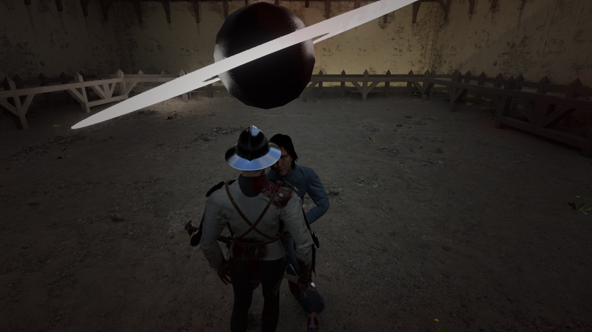
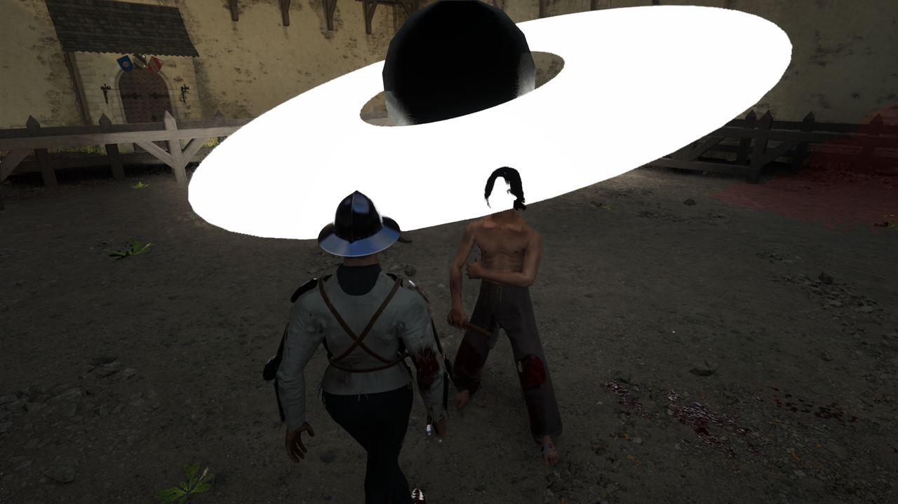

# Validation record — 0.1.0-alpha.1

Tested locally on 2026-11-07. This record distinguishes source tests, successful
native calls, and visually observed behavior.

## Automated checks

| Suite | Passing tests |
|---|---:|
| Framework, lifecycle, bounded force math | 21 |
| Geometry validation and native mesh boundary | 11 |
| Reversible held-weapon settings | 7 |
| Material selection/instance boundary | 12 |
| Python installer, updater, archive/rollback | 30 |
| Total | 81 |

Run the four Lua commands and Python unittest command in the README. Lua syntax
was also checked with `luac -p`. Engine calls in unit tests are mocked; those
tests do not establish gameplay effectiveness.

## Native Half Sword tests

Environment: Half Sword 0.6.1.5, Steam build 24185754; Unreal 5.4; Proton;
UE4SS v3.0.1-1217-g4fb9b615. Other platforms/builds are unverified.

Observed during live testing:

- Hash-verified loader installation, startup, NoxyForge `[ready]` and player
  discovery succeeded. Only NoxyForge was enabled among Lua mods.
- F7 generated a native Actor/ProceduralMeshComponent with authored sphere and
  tilted annulus geometry. All former desktop effect overlays were stopped.
- The engine emissive material resolved and made the ring visibly luminous.
- Movement changed the view of the effect; the native geometry appeared in the
  same depth-rendered scene as the character and environment.
- F7 toggling removed an active effect. The ten-second lifetime returned the
  owned-effect count to zero. F10 logged successful shutdown without errors.
- World transitions allowed fresh effects in subsequent maps.
- F5, F6 and F9 reached their native plugin callbacks. Live reads confirmed `Invulnerable=true`, `Block Spine Breaking=true`, and
  `Max Angular Force=15000`. Their gameplay outcomes require separate
  qualification below.
- Install/update/uninstall were exercised against the real game directory.
  The first uninstall exposed a leftover UE4SS.log blocking reinstall; the tool
  was corrected and regression tests now cover log archiving and reinstall. The corrected tool was
  then exercised live: it archived the runtime log, reported no leftover paths,
  and a fresh installation succeeded.
- The latest pre-test progression saves were backed up separately and restored.
  No saves are included in this repository.

## Limits of this alpha

The ring is a material prototype. It is not a gravitational-lensing shader or a
physically accurate black-hole renderer. Vertex colors depend on the assigned
shader; an existing emissive shader can display white despite colored geometry.
Material parameter names on a raw cooked material are not automatically proven
by a successful setter call. Material reports explicitly retain that distinction.

A private dynamic material instance was created and parameter setters completed
without a Lua error; the white result shows those guessed parameter names do not
establish the intended orange color.

The force model is finite, softened and capped; impulse calls executed without
reported Lua errors, but attraction strength and gameplay balance are not yet
quantitatively validated. Dedicated wall-occlusion testing is pending.

Protection presets did not reverse a severe injury already present in a resumed
fight. This is not a healing system or a guarantee against every death rule.
Standing support is not a full ragdoll disable. The game initializes weapon sharpness after actor creation; a 0.75-second
per-weapon warm-up now precedes baseline capture. Engine-computed fields may
still change between mod ticks. Ten times a sharpness parameter
is not ten times observed damage; zero-sharpness fists stay at zero. Unit tests
verify snapshot restoration; the live gameplay effects remain experimental.

OnUnload cleanup is best effort. F10 before reload is the supported cleanup
path; hot reload is disabled by the installer. This is not yet a crash-recovery
system for arbitrary third-party plugins.
